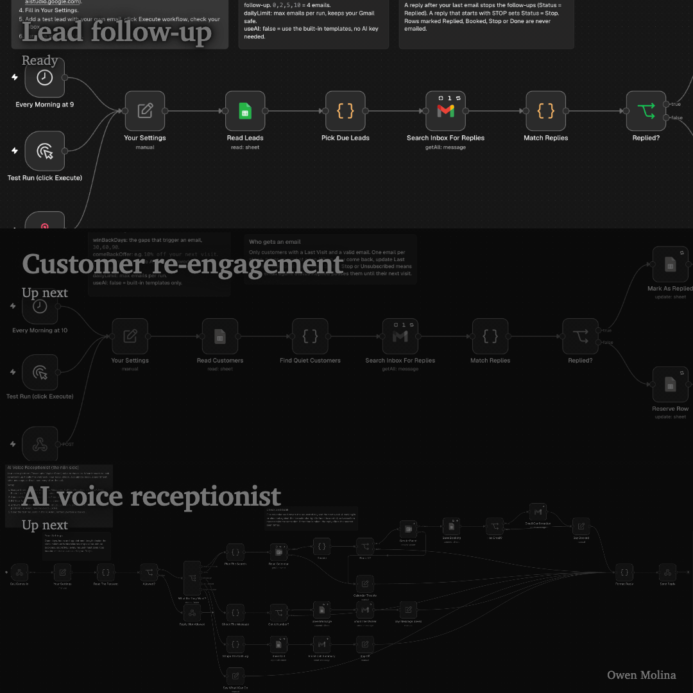

# Free n8n Automation Templates

Three ready-to-use n8n workflows that small businesses already pay hundreds to thousands of dollars for. Download them, plug in your own accounts, and run them for your own business or set them up for your clients.

Everything runs on free tiers: n8n, Google Sheets, Gmail, Google Calendar and the free Gemini API. You do not need a paid AI subscription.

## The templates

| | Template | What it does | Best for |
|---|---|---|---|
| 1 | [**Lead Follow-up System**](templates/lead-follow-up/) | Emails every new lead within a day, follows up on day 2, 5 and 10, and stops the moment they reply. | Real estate, law firms, home services, agencies |
| 2 | [**Customer Re-engagement**](templates/customer-re-engagement/) | Emails past customers 30, 60 and 90 days after their last visit to bring them back. | Med spas, gyms, salons, dental clinics |
| 3 | [**AI Voice Receptionist**](templates/ai-voice-receptionist/) | The n8n side of a phone agent on ElevenLabs, Vapi or Retell. Checks your calendar, books visits, takes messages and logs every call. | Clinics, med spas, hotels, home services |

Each template folder has its own guide with screenshots of the full workflow, an example Google Sheet, step-by-step setup and a troubleshooting section.

## Quick start

1. **Download** the template's `.json` file. Not sure how? See [How to download](docs/how-to-download.md).
2. **Import** it into n8n: open a new workflow, click the **...** menu at the top right, and choose **Import from File**.
3. **Connect your accounts** (Google and Gemini). See [Connect your accounts](docs/connect-your-accounts.md).
4. **Follow the template's guide**, test with your own email, then switch it on.

Setup takes about 10 minutes for the email templates and 30 minutes for the voice receptionist.

## What is already handled for you

These are the things that usually break when people build these workflows themselves:

- **No double emails.** Each row is reserved before the email goes out and released again if the send fails, so two runs can never email the same person twice.
- **Replies stop the sequence.** Every run checks Gmail for replies. When someone answers, their emails stop and you get an alert so you can take over.
- **AI with a safety net.** Gemini writes each email. If AI is switched off, out of free quota, or writes something it should not (like a discount you never offered), a ready-made template is sent instead. No lead is ever skipped.
- **Daily limits** protect your Gmail account from being flagged.
- **An easy STOP line** in every email. A STOP reply is respected forever.
- **No double bookings.** The voice receptionist re-checks the live calendar right before it books.

## Guides

| Guide | Read it when |
|---|---|
| [How to download](docs/how-to-download.md) | You have never downloaded a file from GitHub |
| [Connect your accounts](docs/connect-your-accounts.md) | You are setting up Google Sheets, Gmail, Calendar or Gemini in n8n |
| [Selling these to clients](docs/selling-to-clients.md) | You want to offer these as a service, with use cases and pricing |
| [FAQ](docs/faq.md) | Something is unclear or not working |

## Requirements

- An n8n account, either [n8n Cloud](https://n8n.io) or self-hosted (version 1.0 or newer)
- A Google account (Gmail or Google Workspace)
- A free Gemini API key from [Google AI Studio](https://aistudio.google.com) (optional, the email templates also work with AI off)
- For the voice receptionist: an account on [ElevenLabs](https://elevenlabs.io), [Vapi](https://vapi.ai) or [Retell](https://www.retellai.com)

## Safe to use

None of these files contain API keys, passwords, account IDs or personal data. After you import a workflow, you connect your own accounts inside n8n. Your keys never leave your n8n.

## License

[MIT](LICENSE). Use them, change them, and sell the setup to your clients. A mention is appreciated but not required.

Made by Owen Molina.
