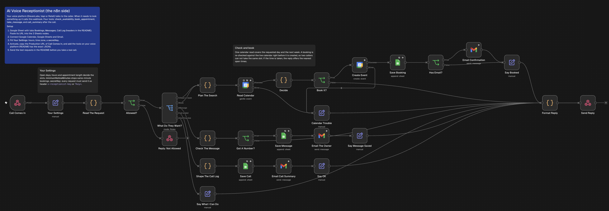
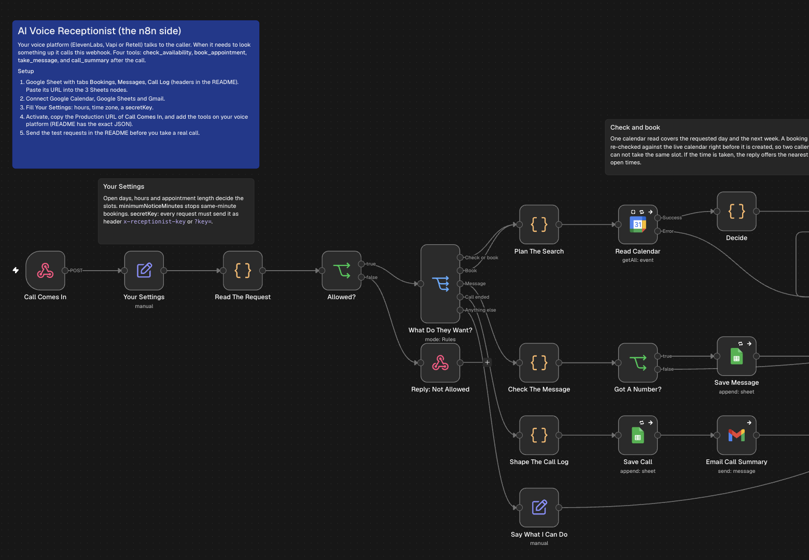
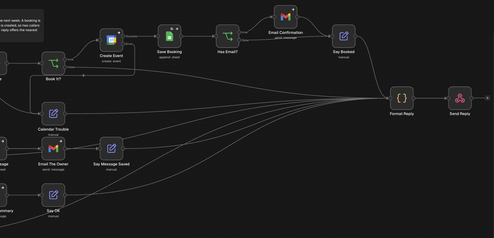
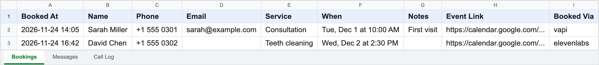

# AI Voice Receptionist

[Back to all templates](../../README.md) · [Download the workflow](ai-voice-receptionist.json)

The n8n brain behind an AI phone receptionist. Your voice platform (ElevenLabs, Vapi or Retell) talks to the caller. Whenever the agent needs to look something up or act, it calls this one webhook. n8n checks your Google Calendar, books the visit, takes a message, or logs the call, and answers with a sentence the agent can say.

One workflow, any of the three voice platforms. No missed calls, no double bookings.



## Use cases

- **Dental or medical clinic.** Patients call after hours, hear the open times for tomorrow, and book themselves in. The front desk sees the booking in the calendar the next morning.
- **Med spa.** "Do you have anything Friday afternoon?" gets a real answer from the live calendar, and the client gets a confirmation email.
- **Hotel or rental.** Guests leave a message any time of day, and the team gets it by email with a callback number.
- **Home services.** While the owner is on a job, the receptionist books the estimate visit and logs a summary of every call.

## What it can do

| Tool | What happens |
|---|---|
| `check_availability` | Reads your calendar and answers with up to five open times on the requested day, or the next day that has openings. |
| `book_appointment` | Re-checks the slot against the live calendar, creates the event, saves the booking to Sheets and emails the caller a confirmation. If the time was just taken, it offers the nearest open times. |
| `take_message` | Saves the caller's name, number and message to Sheets and emails the team. |
| `call_summary` | Sent by the platform when the call ends. Logs the summary and transcript and emails you. |

Opening days, hours, appointment length and minimum notice all come from **Your Settings**, so it never books outside business hours or in the past.

## What you need

- n8n (Cloud, or self-hosted with a public URL)
- A Google account for Calendar, Sheets and Gmail
- An account on ElevenLabs, Vapi or Retell, with a phone number connected to your agent
- About 30 minutes

## How it works

### Part 1: Receive the request and route it



1. **Call Comes In** receives every request from your voice platform.
2. **Read The Request** understands the format of all three platforms and pulls out the tool name and details.
3. **Allowed?** checks your secret key. Requests without it get **Reply: Not Allowed**.
4. **What Do They Want?** sends the request to the right branch: check or book, take a message, or log the call.

### Part 2: Check, book, save and answer



- **Check and book:** **Plan The Search** and **Read Calendar** read the next week in one go. **Decide** finds open times or checks the requested slot. **Create Event**, **Save Booking** and **Email Confirmation** book it. If the calendar cannot be reached, **Calendar Trouble** offers to take a message instead.
- **Message:** **Check The Message**, **Save Message** and **Email The Owner**.
- **Call ended:** **Shape The Call Log**, **Save Call** and **Email Call Summary**.
- **Format Reply** and **Send Reply** answer in the exact format each platform expects.

## Setup

### Step 1: Download and import

Download [`ai-voice-receptionist.json`](ai-voice-receptionist.json) and import it into n8n (**...** menu, **Import from File**). New to this? See [How to download](../../docs/how-to-download.md).

### Step 2: Create your Google Sheet

Create one Google Sheet with three tabs, and these headers in row 1 of each:

| Tab | Headers |
|---|---|
| `Bookings` | `Booked At, Name, Phone, Email, Service, When, Notes, Event Link, Booked Via` |
| `Messages` | `Received At, Name, Phone, Message, Via` |
| `Call Log` | `Ended At, Caller, Seconds, Summary, Transcript, Via` |



The workflow fills every row by itself.

### Step 3: Paste your sheet link

Paste the sheet's URL into the three Sheets nodes: **Save Booking**, **Save Message** and **Save Call** (under **Document**, choose **By URL**).

### Step 4: Connect your accounts

Connect Google Calendar, Google Sheets and Gmail. Step-by-step: [Connect your accounts](../../docs/connect-your-accounts.md).

### Step 5: Fill in Your Settings

| Setting | What to put | Example |
|---|---|---|
| `businessName` | Your business, used in the confirmation email | `Bright Smile Dental` |
| `timezone` | Your time zone | `America/New_York` |
| `openDays` | Days you take appointments | `Mon,Tue,Wed,Thu,Fri` |
| `openTime`, `closeTime` | Opening hours | `09:00`, `17:00` |
| `appointmentMinutes` | Length of one appointment | `30` |
| `minimumNoticeMinutes` | Stops same-minute bookings | `60` |
| `daysToSearch` | How far ahead to look for openings | `7` |
| `calendarId` | Your Google Calendar ID. For your main calendar it is your Gmail address | `you@example.com` |
| `ownerEmail` | Where messages and call summaries go | `frontdesk@example.com` |
| `secretKey` | **Change this.** A long random string. Every request must send it | `k8Qz2...` |

### Step 6: Activate and copy your webhook URL

Switch the workflow to **Active**. Open the **Call Comes In** node and copy the **Production URL**. It looks like `https://YOUR-N8N/webhook/ai-receptionist`.

### Step 7: Connect your voice platform

Every request must carry your `secretKey`, either as the header `x-receptionist-key` or as `?key=` on the URL. Use the header where your platform allows it.

#### Tool parameters (same on every platform)

```json
[
  {
    "name": "check_availability",
    "description": "Check open appointment times. Call this before offering or booking a time.",
    "parameters": {
      "type": "object",
      "properties": {
        "date": { "type": "string", "description": "Day to check, as YYYY-MM-DD. Use today's date if the caller has no preference." }
      },
      "required": ["date"]
    }
  },
  {
    "name": "book_appointment",
    "description": "Book an appointment at a time the caller chose from the open times.",
    "parameters": {
      "type": "object",
      "properties": {
        "name":    { "type": "string", "description": "Caller's full name" },
        "phone":   { "type": "string", "description": "Caller's phone number" },
        "email":   { "type": "string", "description": "Caller's email, for the confirmation (optional)" },
        "service": { "type": "string", "description": "What the appointment is for" },
        "start":   { "type": "string", "description": "Start time as YYYY-MM-DDTHH:mm in the business time zone" },
        "notes":   { "type": "string", "description": "Anything else the team should know" }
      },
      "required": ["name", "phone", "service", "start"]
    }
  },
  {
    "name": "take_message",
    "description": "Take a message for the team when the caller does not want to book, or asks for a person.",
    "parameters": {
      "type": "object",
      "properties": {
        "name":   { "type": "string", "description": "Caller's name" },
        "phone":  { "type": "string", "description": "Number to call back" },
        "reason": { "type": "string", "description": "The message" }
      },
      "required": ["name", "phone", "reason"]
    }
  }
]
```

Tell the agent today's date in its system prompt (most platforms have a date variable) so it can turn "tomorrow" into a date.

#### Vapi

- Add the three tools as **Function** tools with the parameters above. Set each tool's server URL to your Production URL and add the header `x-receptionist-key`.
- In the assistant's **Server URL** settings, use the same URL (with `?key=YOUR-SECRET`) and turn on the **end-of-call-report** message. That sends the `call_summary` automatically.

#### Retell

- Add the three tools as **Custom Functions** with the parameters above. URL: your Production URL with `?key=YOUR-SECRET`.
- Set the agent's webhook URL to the same address. The `call_ended` or `call_analyzed` event is logged as the `call_summary`.

#### ElevenLabs

- Add the three tools as **Webhook** (server) tools, method POST, with the parameters above as body parameters. Give each its own URL with the tool name and key:
  `https://YOUR-N8N/webhook/ai-receptionist?action=check_availability&key=YOUR-SECRET`
- Add a **post-call webhook** pointing at `https://YOUR-N8N/webhook/ai-receptionist?key=YOUR-SECRET`. The transcription event is logged as the `call_summary`.

### Step 8: Test it before a real call

Any platform not listed above can send a plain JSON body with an `action` field. Use the same format to test from a terminal:

```bash
curl -X POST "https://YOUR-N8N/webhook/ai-receptionist" \
  -H "Content-Type: application/json" -H "x-receptionist-key: YOUR-SECRET" \
  -d '{"action":"check_availability","date":"2026-12-01"}'

curl -X POST "https://YOUR-N8N/webhook/ai-receptionist" \
  -H "Content-Type: application/json" -H "x-receptionist-key: YOUR-SECRET" \
  -d '{"action":"book_appointment","name":"Test Caller","phone":"+15555550123","service":"Consultation","start":"2026-12-01T10:00"}'
```

Each call answers with `{ "result": "..." }`, the sentence the agent will say. Vapi gets the `results` format it expects. Delete the test event from your calendar afterwards.

## Troubleshooting

| Problem | Fix |
|---|---|
| The agent says it cannot reach the calendar | Check the Google Calendar credential and that `calendarId` is right (your Gmail address for your main calendar) |
| Every request gets "missing or wrong x-receptionist-key" | The key on your voice platform must match `secretKey` exactly |
| No open times are offered | Check `openDays`, `openTime`, `closeTime` and `timezone` in Your Settings |
| Calls are not logged | Turn on the end-of-call webhook on your platform (Vapi: end-of-call-report, Retell: call_ended, ElevenLabs: post-call webhook) |
| Nothing reaches n8n | The workflow must be **Active**, and you must use the Production URL, not the Test URL |

More answers in the [FAQ](../../docs/faq.md).
