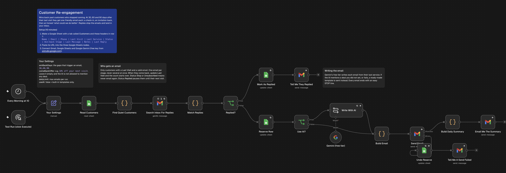
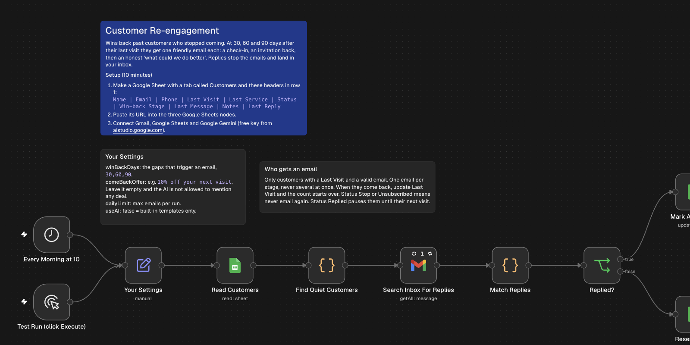
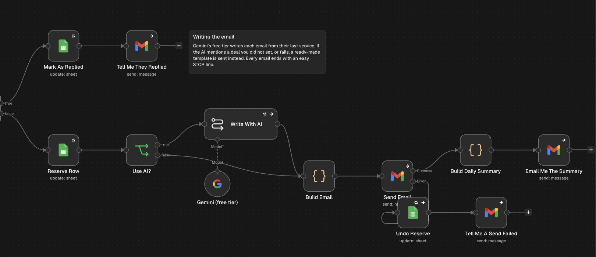
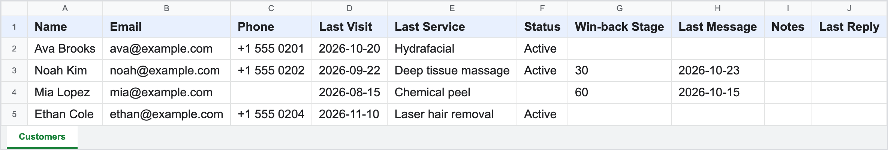

# Customer Re-engagement

[Back to all templates](../../README.md) · [Download the workflow](customer-re-engagement.json)

Wins back past customers who stopped coming. At 30, 60 and 90 days after their last visit, each customer gets one friendly email: a check-in, an invitation back, then an honest "what could we do better". Replies stop the emails and land in your inbox.

Getting a past customer back costs far less than finding a new one. This workflow does it quietly every morning.



## Use cases

- **Med spa.** A client who had a Hydrafacial 30 days ago gets a check-in about their skin. At 60 days, an invitation to book again. At 90, a short "how can we do better".
- **Gym or studio.** Members who stopped showing up get a friendly nudge before they cancel.
- **Salon or barber.** Regulars who drift away are invited back, with their last service mentioned.
- **Dental clinic.** Patients overdue for a cleaning get a personal reminder.

## What you need

- n8n (Cloud or self-hosted)
- A Google account for Sheets and Gmail
- A free Gemini API key (optional)
- About 10 minutes

## How it works

### Part 1: Find quiet customers and check for replies



1. **Every Morning at 10** starts the workflow. **Test Run** lets you start it by hand.
2. **Your Settings** holds your business details, the win-back days and an optional offer.
3. **Read Customers** reads your Google Sheet.
4. **Find Quiet Customers** finds who passed 30, 60 or 90 days since their last visit and has not had that stage's email yet.
5. **Search Inbox For Replies** and **Match Replies** check whether they already answered.

### Part 2: Stop on reply, or write and send the win-back email



- **Replied:** **Mark As Replied** pauses them and **Tell Me They Replied** emails you.
- **Not replied:**
  1. **Reserve Row** marks the row first, so no customer gets two emails.
  2. **Write With AI** (Gemini) writes the email from their last service and the stage they are in.
  3. **Build Email** blocks any deal you did not set. If the AI invents a discount, or fails, a ready-made template is sent instead.
  4. **Send Email** sends it from your Gmail. If Gmail refuses, **Undo Reserve** puts the row back and you are told.
- **Email Me The Summary** sends you a list of everyone contacted today.

## Setup

### Step 1: Download and import

Download [`customer-re-engagement.json`](customer-re-engagement.json) and import it into n8n (**...** menu, **Import from File**). New to this? See [How to download](../../docs/how-to-download.md).

### Step 2: Create your Google Sheet

Create a Google Sheet with a tab named **`Customers`** and these headers in row 1, spelled exactly like this:

```
Name | Email | Phone | Last Visit | Last Service | Status | Win-back Stage | Last Message | Notes | Last Reply
```



- `Last Visit` must be a date, like `2026-10-01`.
- `Last Service` (for example `Hydrafacial` or `deep cleaning`) makes the email personal.
- The workflow fills in `Win-back Stage`, `Last Message` and `Last Reply` on its own.

Export your customer list from your booking system (Vagaro, Mindbody, Square, Jane, Boulevard) and paste it in.

### Step 3: Paste your sheet link

Paste your sheet's URL into the four Google Sheets nodes: **Read Customers**, **Mark As Replied**, **Reserve Row** and **Undo Reserve** (under **Document**, choose **By URL**).

### Step 4: Connect your accounts

Connect Google Sheets, Gmail and Gemini. Step-by-step: [Connect your accounts](../../docs/connect-your-accounts.md).

### Step 5: Fill in Your Settings

| Setting | What to put | Example |
|---|---|---|
| `yourName` | Your name, signs the emails | `Jane Smith` |
| `businessName` | Your business | `Glow Aesthetics` |
| `comeBackOffer` | An offer to include. Leave it empty and the AI may not mention any deal | `10% off your next visit` |
| `bookingLink` | Your booking page | `https://example.com/book` |
| `ownerEmail` | Where reply alerts and the summary go | `jane@example.com` |
| `winBackDays` | The gaps that trigger an email | `30,60,90` |
| `dailyLimit` | Max emails per run | `20` |
| `useAI` | `true` = Gemini writes the emails, `false` = built-in templates | `true` |

### Step 6: Set your time zone

Open **Workflow settings** and set your time zone. It starts as `America/New_York`.

### Step 7: Test it

1. Add yourself as a customer with your own email and a `Last Visit` 31 days ago.
2. Click **Execute workflow** and check your inbox.
3. Run it again. You do not get a second email, because the 30-day stage is done.

### Step 8: Turn it on

Switch the workflow to **Active**.

## Rules

- Only customers with a `Last Visit` and a valid email are contacted.
- One email per stage, never several at once.
- When a customer comes back, update `Last Visit` and the count starts over.
- Status `Stop` or `Unsubscribed` means never email again.
- Status `Replied` pauses them until their next visit.

## Customize it

- **Different timing:** change `winBackDays`, for example `21,45,90` for a salon.
- **Seasonal offer:** set `comeBackOffer` for the month and clear it after.
- **Your own wording:** edit the prompt in **Write With AI** or the templates in **Build Email**.

## Troubleshooting

| Problem | Fix |
|---|---|
| Nobody got an email | `Last Visit` must be a real date at least 30 days ago, and row 1 headers must match exactly |
| A customer was skipped | Their status is `Stop`, `Unsubscribed` or `Replied`, or they already had this stage's email |
| The AI email was replaced by a template | The AI mentioned a deal you did not set, or Gemini was unavailable. This is by design |

More answers in the [FAQ](../../docs/faq.md).
