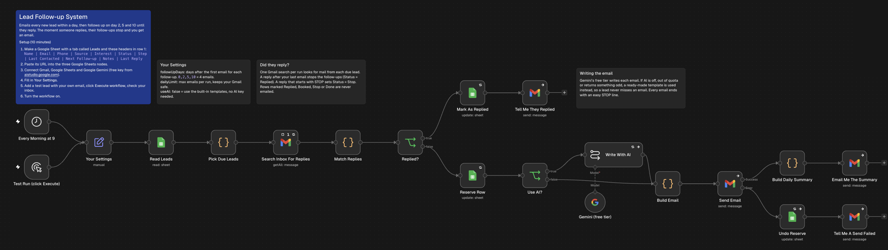
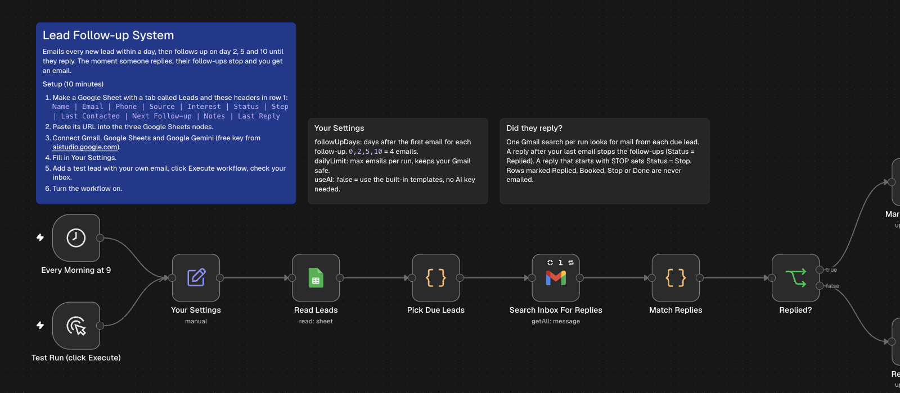
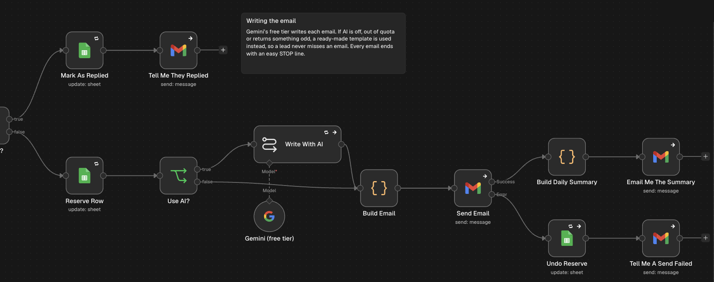
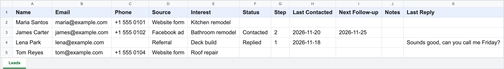

# Lead Follow-up System

[Back to all templates](../../README.md) · [Download the workflow](lead-follow-up.json)

Emails every new lead within a day, then follows up on day 2, 5 and 10 until they reply. The moment someone replies, their follow-ups stop and you get an email so you can take over.

Most leads are lost because nobody followed up. This workflow does the following up for you, every morning, from your own Gmail.



## Use cases

- **Real estate agent.** Every buyer inquiry from your website or ads lands in the sheet. The workflow replies the same day, follows up three more times, and alerts you the moment the buyer answers.
- **Law firm.** People who asked about a consultation but never booked get a polite reminder sequence with your booking link.
- **Home services** (remodeling, roofing, solar). Quote requests get a fast reply while you are on a job, so they do not go to the next contractor.
- **Agency or consultant.** Leads from a form, a webinar or LinkedIn get a personal follow-up until they book a call.

## What you need

- n8n (Cloud or self-hosted)
- A Google account for Sheets and Gmail
- A free Gemini API key (optional)
- About 10 minutes

## How it works

### Part 1: Find who is due and check for replies



1. **Every Morning at 9** starts the workflow. **Test Run** lets you start it by hand.
2. **Your Settings** holds your name, business, booking link and follow-up schedule.
3. **Read Leads** reads your Google Sheet.
4. **Pick Due Leads** picks who is due today, based on their step and the last time they were contacted. It respects your daily limit.
5. **Search Inbox For Replies** runs one Gmail search for mail from those leads.
6. **Match Replies** and **Replied?** split the leads into two groups: replied, and still waiting.

### Part 2: Stop on reply, or write and send the next email



- **Replied:** **Mark As Replied** sets their status to `Replied` and saves their reply. **Tell Me They Replied** emails you so you can take over.
- **Still waiting:**
  1. **Reserve Row** marks the row first, so a second run can never email the same lead twice.
  2. **Use AI?** checks your setting. **Write With AI** (Gemini) writes a short, personal email for this step.
  3. **Build Email** checks the AI's email and falls back to a ready-made template if anything looks wrong. Every email ends with an easy STOP line.
  4. **Send Email** sends it from your Gmail.
  5. If Gmail refuses the email, **Undo Reserve** puts the row back and **Tell Me A Send Failed** emails you.
- **Build Daily Summary** and **Email Me The Summary** send you a list of everyone contacted today.

## Setup

### Step 1: Download and import

Download [`lead-follow-up.json`](lead-follow-up.json) and import it into n8n (**...** menu, **Import from File**). New to this? See [How to download](../../docs/how-to-download.md).

### Step 2: Create your Google Sheet

Create a Google Sheet with a tab named **`Leads`** and these headers in row 1, spelled exactly like this:

```
Name | Email | Phone | Source | Interest | Status | Step | Last Contacted | Next Follow-up | Notes | Last Reply
```



For a new lead you only fill in `Name` and `Email`. `Source` and `Interest` make the email more personal. The workflow fills in `Status`, `Step`, `Last Contacted`, `Next Follow-up` and `Last Reply` on its own.

### Step 3: Paste your sheet link

Copy your sheet's URL and paste it into the four Google Sheets nodes: **Read Leads**, **Mark As Replied**, **Reserve Row** and **Undo Reserve** (under **Document**, choose **By URL**).

### Step 4: Connect your accounts

Connect Google Sheets, Gmail and Gemini. Step-by-step: [Connect your accounts](../../docs/connect-your-accounts.md).

### Step 5: Fill in Your Settings

Open the **Your Settings** node and replace the example values:

| Setting | What to put | Example |
|---|---|---|
| `yourName` | Your name. Signs the emails and shows as the sender | `Jane Smith` |
| `businessName` | Your business | `Smith Remodeling` |
| `whatYouOffer` | What you sell, in a few words. The AI uses it | `kitchen and bathroom remodeling` |
| `bookingLink` | Your calendar or booking page | `https://calendly.com/your-name` |
| `ownerEmail` | Where reply alerts and the daily summary go | `jane@example.com` |
| `followUpDays` | Days after the first email for each email | `0,2,5,10` (4 emails) |
| `dailyLimit` | Max emails per run | `20` |
| `useAI` | `true` = Gemini writes the emails, `false` = built-in templates | `true` |

### Step 6: Set your time zone

Open **Workflow settings** (the **...** menu) and set your time zone, so "every morning" is your morning. It starts as `America/New_York`.

### Step 7: Test it

1. Add yourself as a lead in the sheet, with your own email.
2. Click **Execute workflow**.
3. Check your inbox for the email and the daily summary.
4. Reply to the email, then run it again. Your row changes to `Replied` and you get an alert.

### Step 8: Turn it on

Switch the workflow to **Active**. It now runs every morning by itself.

## Status values

| Status | What happens |
|---|---|
| empty or `New` | Gets the first email |
| `Contacted` | In the sequence, gets the next email when due |
| `Done` | Got the last email. The sequence is finished |
| `Replied` | Stopped because they replied |
| `Stop` | They replied STOP. Never emailed again |
| `Booked` | Never emailed. Set this yourself when they book |

## Customize it

- **Different schedule:** change `followUpDays`, for example `0,1,3,7,14` for five emails.
- **Different time:** change the hour in **Every Morning at 9**.
- **Your own wording:** edit the prompt in **Write With AI**, or the templates in **Build Email**.
- **Leads from a form:** point your website form, Typeform or Facebook Lead Ads at the same sheet (Zapier, Make or an n8n form) and new leads join the sequence the next morning.

## Troubleshooting

| Problem | Fix |
|---|---|
| Nobody got an email | Check the `Status` column (only empty, `New` or `Contacted` are emailed) and that row 1 headers match exactly |
| A node shows a red warning | It has no credential yet. Open it and pick your account |
| The AI email is skipped | Gemini is off, out of free quota, or wrote something odd. The template was sent instead, which is by design |
| Same lead emailed twice | Make sure all four Sheets nodes point at the same sheet |

More answers in the [FAQ](../../docs/faq.md).
